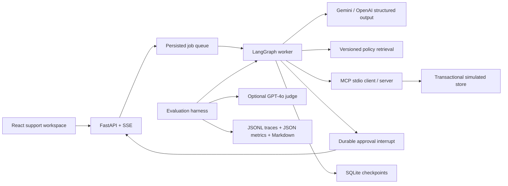

# ResolveDesk

An evidence-backed customer support workspace built with **FastAPI, LangGraph, Gemini/OpenAI, MCP, React, and RAG**. It investigates delivery, damage, and refund-status tickets, proposes cited resolutions, and executes reviewer-approved remedies in a simulated store.

## Public demo and full application

**To avoid ongoing OpenAI API costs, the public demo uses saved agent workflows instead of running live AI investigations.** It preserves the application's interface, including enquiries, policy evidence, approvals, simulated receipts, and evaluation reports. Investigations replay previously captured results; changing enquiry text does not make a new model call. Demo purchases and decisions affect only sample data stored in your browser.

The full backend and live model integration are included in this repository. To run real investigations with your own API key, follow [Run the full application locally](#run-the-full-application-locally). The [workflow video](docs/design/workflow-luna.mp4) shows an actual Luna run. The evaluation screens display saved historical benchmark results, not new evaluations performed by the hosted demo.


## Architecture



- **LangGraph:** conditional investigation, policy checks, saved checkpoints, approval interrupt/resume, and post-action verification.
- **Gemini / OpenAI:** intent classification and structured, grounded resolution drafting. Deterministic code constrains allowed actions.
- **MCP:** actual JSON-RPC over stdio to a separate Python server; order, shipment, refund, inventory, history, and approved-resolution tools.
- **RAG:** Hybrid BM25 plus locally cached sentence-transformer embeddings over four versioned policy sections, fused with reciprocal rank fusion. If the embedding model is unavailable, retrieval falls back to the existing TF-IDF ranking. Citations resolve to exact source IDs and content hashes.
- **SQLite:** durable app records, transactions, idempotent receipts, and graph checkpoints. Each evaluation uses an isolated temporary database.
- **FastAPI:** cookie sessions, role/ownership checks, reconnectable event streams, ticket APIs, approval endpoints, and evaluation reports. API reference: `/docs`.

## Why this is not just a chatbot

ResolveDesk uses LLMs for bounded judgment, then surrounds them with deterministic product logic. The model classifies intent and drafts a grounded response, but code decides which actions are allowed, validates citations against retrieved policy IDs, blocks mutations until reviewer approval, and rechecks store state before executing anything.

That means the demo shows a real support workflow rather than a free-form chat box: tickets, evidence, policy retrieval, MCP tool calls, approval interrupts, receipts, audit events, and evaluation reports are all first-class product surfaces.

## Demo flow

**Watch a real Luna workflow:** damaged-order ticket → investigation → cited policies and order evidence → reviewer approval → verified replacement receipt.

[](docs/design/workflow-luna.mp4)

[Watch the full-quality video (MP4, 54 seconds)](docs/design/workflow-luna.mp4) · [Unedited browser recording (WebM)](docs/design/workflow-luna.webm) · [Recording and editing source](docs/design/workflow-source/README.md)

Recorded on October 20, 2026 with `AGENT_MODE=luna` and `OPENAI_AGENT_MODEL=gpt-6-luna`: two live model calls, six MCP tool calls, human approval, and a verified simulated replacement. Retrieval uses BM25/TF-IDF with embeddings disabled. The captioned edit removes loading waits; the Evaluations screen shows a saved historical 90-case benchmark, separate from this run. No real orders or payments are involved.

| Inbox and evidence | Approval gate |
| --- | --- |
|  |  |

| Verified receipt | Evaluation reports |
| --- | --- |
|  |  |

## Try the workflow

1. Open the damaged-headphones ticket and click **Start investigation**.
2. Follow classification, policy retrieval, and MCP order/inventory checks.
3. Read the proposed replacement and cited damage policy.
4. **Approve replacement** as Jordan Smith. The app executes and verifies a simulated replacement, then displays its receipt.
5. Run the same ticket again: the existing remedy prevents a second replacement.
6. Investigate the delivery and refund-status tickets for read-only resolutions.
7. Switch demo identity to a customer to verify ticket isolation. Customers cannot approve actions.

New tickets created in reviewer mode explicitly belong to Maya Chen (`ORD-1001`). Alex owns `ORD-1002`; Priya owns `ORD-1003`. Order IDs embedded in message text never determine account scope.

## Safety model (full application)

- **Proposal hash binding:** reviewer decisions are tied to the complete proposal hash, so editing the proposed action, amount, or cited result invalidates the approval.
- **Run-scoped capabilities:** MCP tools receive a random internal capability for the support run, not customer-supplied IDs. The tool server resolves the authorized order and customer from that capability.
- **Transactional execution:** the store rechecks ownership, delivery window, inventory, prior remedies, and exact refund amount in the same transaction that writes the receipt.
- **Idempotent receipts:** each run can create only one receipt, and existing order remedies prevent duplicate refunds or replacements across runs.
- **Post-action verification:** after a mutation, the worker reads the ledger back through MCP before declaring the run resolved. Verification failures escalate instead of retrying blindly.
- **Visible failures:** missing credentials, model errors, unavailable tools, and rejected validations remain visible states rather than silently falling back to fake AI.

## Run the full application locally

Requirements: Python 3.12+, Node.js 20+, Git, and uv. These instructions start the real FastAPI/LangGraph/MCP application with live model calls. Orders and payments remain simulated.

### 1. Clone and install the backend

```powershell
git clone https://github.com/spiderkd/resolvedesk.git
cd resolvedesk
uv sync --python 3.12
if (-not (Test-Path .env)) { Copy-Item .env.example .env }
```

If you already cloned the repository, start from its root and skip `git clone`.

### 2. Configure your model provider

Edit the root `.env` file. For the OpenAI/Luna workflow shown in the video:

```env
AGENT_MODE=luna
OPENAI_API_KEY=your-openai-api-key
OPENAI_AGENT_MODEL=gpt-6-luna
DATABASE_URL=
QDRANT_URL=
QDRANT_API_KEY=
RAG_DISABLE_EMBEDDINGS=false
LANGSMITH_TRACING=false
```

Use a model available to your OpenAI account if `gpt-6-luna` is unavailable. Set `OPENAI_AGENT_MODEL` explicitly: the example configuration's older `gpt-luna` alias may not be available. Live model calls use your own account and incur API usage charges. Never commit `.env` or expose API keys through frontend variables such as `VITE_*`. The static Vercel walkthrough needs no provider keys.

Alternatively, use `AGENT_MODE=gemini`, set `GEMINI_API_KEY`, and choose `GEMINI_MODEL` in `.env`. A Gemini-only investigation does not require an OpenAI key; optional OpenAI evaluation judging does.

Empty database and Qdrant settings keep this setup local: SQLite stores application state, and retrieval uses the local policy corpus. Embeddings may download and load a local model. For a lighter setup, set `RAG_DISABLE_EMBEDDINGS=true` to use BM25/TF-IDF; investigations still make live calls to your configured LLM.

### 3. Build the live frontend and start the server

```powershell
cd apps/web
npm ci
npm run build
cd ../..
uv run python -m uvicorn resolvedesk.api:app --host 127.0.0.1 --port 8000
```

Open **http://localhost:8000**. Use `npm run build` for this setup; `npm run build:walkthrough` creates the separate saved-run demo. The FastAPI server serves the live frontend and starts one background worker. After installing dependencies and building the frontend, you can also start it with `./start.ps1` on Windows.

For frontend development, start the API and run `npm run dev` from `apps/web`; Vite proxies `/api` to FastAPI. The project uses React/Vite.

### Optional: remove the hosted demo data

You may delete the root **`demo/` folder** if you only want to run the full application locally. It contains the public walkthrough's saved workflows, policies, and evaluation copies. The normal `npm run build` and Python backend do not depend on it.

Keep `data/policies/` and `evals/reports/`: these are the full application's policy sources and historical evaluation reports. Keep `apps/web/src/walkthrough/` as well; deleting the optional data folder does not require removing frontend source files.

Deleting `demo/` removes the saved data needed for the walkthrough and Vercel deployment. Restore it from Git, or regenerate it with `uv run python scripts/export_walkthrough.py`, before building that version again. Deletion is optional; leaving the folder in place does not change live mode.

## Run or deploy the saved-workflow demo

The same workspace can run entirely in the browser with five saved investigation workflows, editable sample enquiries, approvals/rejections, simulated receipts, customer/reviewer views, and historical evaluations. Build it with `npm run build:walkthrough` from `apps/web`. The root `vercel.json` configures a Vercel deployment with no backend, database, or API keys. See [deployment and walkthrough setup](docs/deployment.md).

```powershell
cd apps/web
npm ci
npm run build:walkthrough
npm run preview:walkthrough
```

The walkthrough and live application have separate frontend build outputs, so building one does not replace the other.

### Backend fixture mode

For an explicitly offline fixture demo, set `AGENT_MODE=demo`. The interface and reports label this as deterministic demo mode. Missing or rejected Gemini credentials do **not** silently fall back to simulated AI.

This optional backend fixture mode is separate from the static Vercel walkthrough: it still runs the Python backend and MCP tools, but does not call a model.

For small free hosts such as Render Free, also set `RAG_DISABLE_EMBEDDINGS=true`. This keeps retrieval on BM25/TF-IDF and avoids loading the sentence-transformers/Torch stack during the public demo. The saved evaluation reports still appear in the UI because they are read from `evals/reports/`.

```env
AGENT_MODE=demo
DATABASE_URL=
QDRANT_URL=
QDRANT_API_KEY=
QDRANT_COLLECTION=resolvedesk_policies
RAG_DISABLE_EMBEDDINGS=true
LANGSMITH_TRACING=false
```

## Evaluate

The dataset contains 90 synthetic cases in 30 scenario families, with three surface variants per family. Family-level split: 60 development cases and 30 held-out cases. These are developer-authored fixtures, **not an independently human-reviewed benchmark**.

```powershell
# Fast tests: no model calls, real MCP subprocesses
uv run pytest -q
uv run ruff check resolvedesk evals tests

# Full deterministic workflow regression set
uv run python -m evals.run --mode demo

# One live Gemini case per family (30 total), paced for modest quotas
uv run python -m evals.run --mode gemini --limit 30 --workers 2 --interval 8

# Full 90-case Gemini run
uv run python -m evals.run --mode gemini --workers 2 --interval 8

# Retrieval-only Gemini baseline; no live store evidence
uv run python -m evals.run --mode gemini --baseline --limit 30 --workers 2 --interval 8

# Optional GPT-4o API judging, requires OPENAI_API_KEY
uv run python -m evals.run --mode gemini --judge gpt-4o --limit 30
```

Each run writes `evals/reports/<run-id>/config.json`, `results.jsonl`, `summary.json`, and `report.md`. Results include proposals, source texts, tool events, token counts, latency, actual store state, and errors. The UI reads these files. No API keys or capabilities are written to evaluation reports.

Measures include resolution accuracy, intent accuracy, retrieval recall@3, citation-ID validity, action success, unauthorized/duplicate mutations, p50/p95 latency, and token consumption. GPT-4o can separately score semantic faithfulness, citation support, helpfulness, and resolution correctness. Missing judgments are reported as **not run**, never fabricated. Optional price settings enable per-call cost estimates; absent prices mean unavailable, not free.

At the user's request, the initial qualitative review is performed by Codex and saved separately. **It is not a GPT-4o API evaluation.**

## Known limitations

- The public walkthrough replays saved workflows to avoid ongoing model API costs. Arbitrary new AI investigations require the full local application and your own provider credentials.
- Demo identity switching is intentionally public for local testing. It is not production authentication.
- The default local store is SQLite. `DATABASE_URL` enables Postgres/Neon, but multi-worker production deployment is not the default path.
- Orders, payments, shipments, refunds, and replacement receipts are simulated fixtures. No real customer or commerce systems are mutated.
- The evaluation dataset is synthetic and developer-authored. It is useful for regression testing, not a human-reviewed production benchmark.
- Customer messages are sent to the configured model provider during live investigations. The included fixtures are synthetic.
- The local demo should be bound to loopback. Add real identity, secure cookies, rate limiting, deployment hardening, and secret management before exposing it publicly.

## Reliability notes

- Reviewer decisions bind to a hash of the complete proposal. Changing it invalidates approval.
- Store transactions recheck ownership, delivery window, inventory, prior remedies, and exact refund amount.
- A unique receipt per run and existing-order remedy checks prevent duplicate actions, including across different runs.
- The MCP server derives the order/customer from a random internal run capability, not model-selected customer IDs.
- Failed mutation verification escalates instead of retrying blindly. Model failures remain visible failures.
- The worker resumes interrupted jobs from checkpoints on restart. Run only one API worker per store; do not use `--workers` greater than one for Uvicorn.

## Changes from the initial plan

The first runnable implementation uses SQLite instead of PostgreSQL/pgvector, and a single in-process worker thread consuming a persisted queue instead of a separately deployed worker service. The GPT-4o evaluator uses a typed custom rubric rather than Ragas. These choices make the whole project runnable locally while retaining real LangGraph, MCP, live Gemini calls, saved evaluations, and transactional approval behavior. PostgreSQL, Ragas comparison, and production authentication remain follow-up work, not completed features.

## Repository

- `resolvedesk/`: API, worker, graph, model adapter, retrieval, MCP, and store.
- `apps/web/`: React/TypeScript interface.
- `demo/`: optional public walkthrough fixtures; safe to remove for live local use.
- `scripts/export_walkthrough.py`: regenerates sanitized public demo fixtures from saved runs.
- `data/policies/`: versioned policy corpus.
- `evals/cases/`: labeled synthetic cases.
- `evals/reports/`: saved runs and Codex review.
- `tests/`: authorization, policy, MCP, approval, idempotency, and recovery checks.
- `docs/`: design evidence and architecture notes.

## Official references

[LangGraph interrupts](https://docs.langchain.com/oss/python/langgraph/interrupts), [LangGraph persistence](https://docs.langchain.com/oss/python/langgraph/persistence), [MCP Python SDK](https://py.sdk.modelcontextprotocol.io/), [Gemini structured outputs](https://ai.google.dev/gemini-api/docs/structured-output), [OpenAI structured outputs](https://platform.openai.com/docs/guides/structured-outputs).
